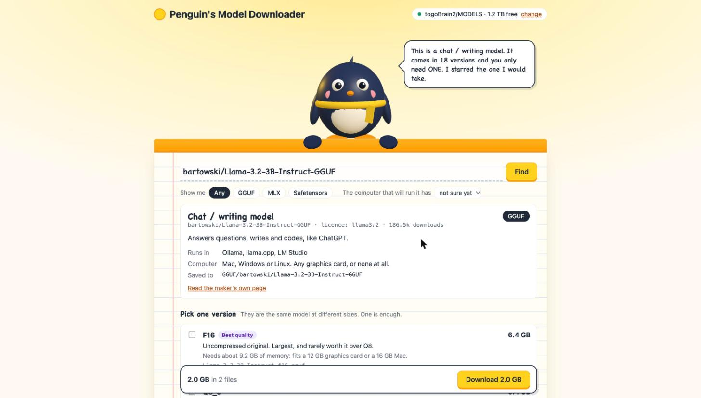

# Penguin's Model Downloader

A friendly little app for downloading AI models from [Hugging Face](https://huggingface.co) to your computer or an external drive. Paste a link onto the penguin's notepad and he tells you, in plain English, what the model is, what software runs it, which file to pick, and whether it will fit your computer.



It runs entirely on your own machine and opens in your browser. Nothing is uploaded anywhere; it only talks to Hugging Face to look up and download models.

## What it does

- **Explains the model.** "Chat / writing model", "Video generator", "Speech-to-text" and so on, with the apps that can run it (Ollama, llama.cpp, LM Studio, ComfyUI, …) and the kind of computer it needs.
- **Helps you pick a file.** Most models come in many sizes. Each one gets a plain note ("Good balance of size and quality"), a memory estimate, and badges such as *Best quality*, *Best balance* and *Smallest*. The penguin stars the one he would take.
- **Checks it will fit.** Tell it how much memory the computer has and every version is marked *Fits*, *A tight fit* or *Too big*.
- **Saves where you want.** This computer, an external drive, or any folder. Downloads are sorted by format so the folder stays tidy.
- **Checks your drive.** It warns when an external drive is formatted in a way that cannot hold model files, and on a Mac it can reformat the drive for you.
- **Handles big downloads.** Progress, speed and time left; cancel and resume; a free-space check before it starts; keeps the computer awake on macOS.

## Getting started

You need **Python 3.9 or newer** and an internet connection. Download this repository (the green **Code** button, then **Download ZIP**, or `git clone` it), then:

| System | How to start |
|---|---|
| macOS | Double-click `start.command` |
| Linux | Run `./start.sh` in a terminal |
| Windows | Double-click `start.bat` |

The first start takes about a minute while it sets up a private Python environment in a `.venv` folder. After that it opens `http://127.0.0.1:8765` in your browser. Close the terminal window to stop the app.

Built and tested on macOS. The Linux and Windows paths are written but have not been tested yet; reports and fixes are welcome.

## Choosing where to save

On first start the app asks where to keep your models. You can change it any time with the **change** link at the top right.

- **This computer** saves into a `MODELS` folder in your home folder.
- **An external drive** saves into a `MODELS` folder on that drive. This is the way to go if you want to carry models to another computer.
- **Another folder** lets you type any path.

Inside that folder, models are sorted like this:

```
MODELS/
  GGUF/<maker>/<model>/          Ollama, llama.cpp, LM Studio
  MLX/<maker>/<model>/           Apple Silicon Macs
  SAFETENSORS/<maker>/<model>/   original weights
```

Each model folder also gets a small `model-info.json` recording where it came from and when.

### How an external drive should be formatted

| Format | Works for models? | Notes |
|---|---|---|
| **exFAT** | Yes, recommended | No file size limit. Readable and writable on Mac, Windows and Linux. |
| **FAT32** | **No** | Cannot hold a file larger than 4 GB. Many USB sticks ship this way. |
| **APFS / Mac OS Extended** | Yes, on Macs | Windows and most Linux computers cannot read it. |
| **NTFS** | Yes, on Windows | Macs can read it but cannot save to it. |

The app shows each drive's format and tells you if there is a problem.

### The built-in formatter (macOS only)

If a drive is in the wrong format, the app offers **Fix it: format this drive…**, which reformats it as exFAT (or APFS).

**Formatting erases everything on the drive, permanently.** Copy anything you want to keep to another disk first. To make accidents unlikely, the app:

- only offers external drives, never the built-in disk or the disk holding your system, home folder or the app itself;
- shows how much data is on the drive and any other volumes that will be erased with it;
- makes you type the drive's current name before the erase button unlocks;
- refuses while downloads are running.

On Windows, format from File Explorer (right-click the drive, **Format**, choose **exFAT**). On Linux, use the **Disks** app.

## Which format do I want?

| | GGUF | MLX | Safetensors |
|---|---|---|---|
| **What it is** | A single file, usually compressed | A version tuned for Apple chips | The original, as released |
| **Runs in** | Ollama, llama.cpp, LM Studio | LM Studio, mlx-lm | transformers, vLLM; ComfyUI for image and video models |
| **Computer** | Mac, Windows or Linux, with or without a graphics card | Apple Silicon Macs only | Best with an NVIDIA graphics card |
| **Pick it when** | You want to chat with a model and are not sure what computer you will use | You know it will run on a Mac | You want the untouched original, or an image or video model |

Names such as **Q4**, **Q8**, **int8** and **bf16** say how tightly a model is squeezed. A smaller number is a smaller file that needs less memory and is a little less sharp. Q4 is the everyday choice, Q8 or 8-bit is nearly the original, and F16 / bf16 is the original itself.

## Using the models afterwards

Models are ordinary files, so you can copy the folder to another computer or plug the drive in and use them from there.

**llama.cpp**

```
llama-server -m /path/to/MODELS/GGUF/<maker>/<model>/<file>.gguf
```

**Ollama** — create a file named `Modelfile` containing one line:

```
FROM /path/to/MODELS/GGUF/<maker>/<model>/<file>.gguf
```

then run `ollama create my-model -f Modelfile` and `ollama run my-model`.

**LM Studio and ComfyUI** — point them at the folder, or copy the file into the app's own models folder.

## Locked ("gated") models

Some models, such as Llama and Gemma, ask you to accept terms first. Accept them on the model's Hugging Face page, then log in once from the app's folder:

```
.venv/bin/hf auth login          # macOS and Linux
.venv\Scripts\hf auth login      # Windows
```

## Settings

| Environment variable | What it does |
|---|---|
| `MODELS_PORT` | Port to run on (default `8765`) |
| `MODELS_DIR` | Save location; overrides the choice made in the app |
| `MODELS_NO_BROWSER=1` | Do not open the browser on start |

Your chosen save location is stored in `config.json` next to the app. That file is ignored by git.

## Good to know

- The notes and memory figures are worked out from file names and sizes, not from each maker's documentation. Treat the memory numbers as rough estimates, and read the model's own page when it matters.
- The app listens on `127.0.0.1` only, so other devices on your network cannot reach it.
- One model downloads at a time; others wait in a queue.
- Temporary download files are kept next to the models (in `.hf-cache` and each model's `.cache` folder), not on your system disk.

## How it is built

- `app.py` — the local web server, model lookups and the download queue (Python standard library plus [`huggingface_hub`](https://github.com/huggingface/huggingface_hub))
- `storage.py` — save locations, drive format checks and the macOS formatter
- `index.html` — the whole interface, including the penguin
- `vendor/three.module.min.js` — [three.js](https://threejs.org) r160, MIT licensed, bundled so the app needs no CDN

This project is not affiliated with Hugging Face.
